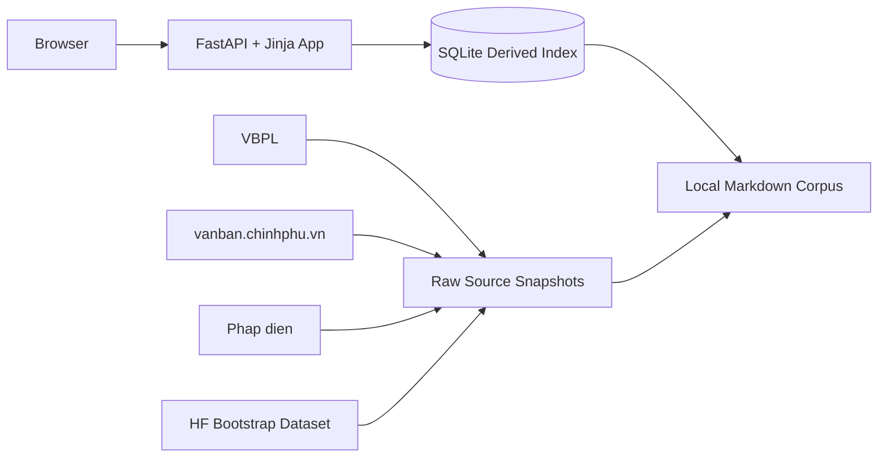

# V-Legal Prototype

V-Legal is being repointed toward a **full local-first markdown port of Vietnamese law**.

The target product is:

- a filesystem-backed legal corpus where every law document becomes structured markdown
- a rebuildable SQLite index for search, passages, citations, relations, and vectorless RAG
- official-source provenance from `vbpl.vn`, `vanban.chinhphu.vn`, and `phapdien.moj.gov.vn`
- a document-first reading experience inspired by the strengths of `thuvienphapluat.vn`

This direction is closer to the `legalize-es` model than to the previous focused-corpus prototype.

## Status

This repo currently contains a working FastAPI + SQLite prototype, but the architecture is in transition.

- the old focused economy/finance corpus direction is now legacy
- Appwrite is no longer the target data architecture
- the next major implementation step is a canonical markdown corpus under `data/corpus/`
- the Hugging Face dataset remains useful for bootstrap and backfill, but not as the final source of truth

### Current Corpus Snapshot

As of the latest local build (`data/corpus/manifests/corpus_summary.json`):

- `153,926` canonical markdown documents under `data/corpus/markdown/` (`153,620` issued, `306` Phap dien)
- coverage years `1925`–`2026`
- derived SQLite index at `data/corpus/sqlite/vlegal.sqlite`

Recent search/reader correctness and performance work is tracked in `docs/IMPROVEMENT_PLAN.md`, including a one-time `document_number_norm` backfill migration (`scripts/migrate_add_search_indexes.py`).

## Target Architecture



## Core Principles

- markdown is the source of truth
- SQLite is derived and rebuildable
- raw source snapshots are preserved for provenance
- official sources outrank third-party snapshots
- deterministic parsing comes before AI-assisted repair
- vectorless RAG should work directly from markdown-derived indexes

## Official Source Strategy

- `vbpl.vn`: primary source for promulgated-document metadata, legal status, relationships, and HTML text when available
- `vanban.chinhphu.vn`: secondary freshness source for newly issued government texts and official PDFs
- `phapdien.moj.gov.vn`: primary source for codified topic and effective-law structure
- `th1nhng0/vietnamese-legal-documents`: bootstrap and backfill source only
- `VN-Law-Advisor`: reference implementation for crawler ideas only
- `thuvienphapluat.vn`: UI and workflow benchmark only, not a source dependency

## Documentation Map

| Document | Purpose |
| --- | --- |
| `docs/FULL_MARKDOWN_PORT_PLAN.md` | phase-by-phase plan for the full markdown port |
| `docs/CORPUS_ARCHITECTURE.md` | canonical local-first corpus architecture |
| `docs/MARKDOWN_SCHEMA.md` | frontmatter, path, and body rules for canonical markdown |
| `docs/SOURCE_UPDATE_WORKFLOW.md` | official-source update and reconciliation workflow |
| `docs/AI_PARSING_POLICY.md` | when AI parsing helps and when it should stay out of the critical path |
| `docs/PDF_OCR_STRATEGY.md` | recommended OCR stack and PDF-to-markdown structure mapping |
| `docs/LEGAL_READER_IMPLEMENTATION_PLAN.md` | reader and interaction plan |
| `docs/JOURNAL.md` | development log |
| `DESIGN.md` | visual design system |

## Current Repo Map

### Core Modules (`src/vlegal_prototype/`)

| File | Responsibility |
| --- | --- |
| `app.py` | FastAPI routes, page assembly, startup initialization |
| `settings.py` | environment config via `pydantic-settings` |
| `db.py` | SQLite schema, FTS tables, and connection helpers |
| `search.py` | FTS search, document retrieval, and filtering |
| `structure.py` | legal text structure, display parsing, inline reference linking |
| `citations.py` | citation extraction and graph queries |
| `relations.py` | lifecycle and relationship graph |
| `compare.py` | side-by-side document comparison |
| `answering.py` | conservative grounded brief generation |
| `vectorless.py` | lexical retrieval profile for vectorless RAG |
| `provenance.py` | VBPL and VNCP provenance profiles |
| `tracking.py` | same-subject update alerts |
| `appwrite_client.py` | legacy integration path, no longer the target architecture |

### Existing Scripts (`scripts/`)

These scripts reflect the current prototype state and will be superseded gradually by markdown-first exporters and rebuilders.

| Script | Current Purpose |
| --- | --- |
| `bootstrap_hf_dataset.py` | import corpus from Hugging Face into SQLite |
| `bootstrap_hf_focused_corpus.py` | legacy focused-corpus rebuild |
| `update_hf_monthly.py` | incremental update from Hugging Face snapshot |
| `export_hf_markdown_corpus.py` | export the HF bootstrap corpus into canonical markdown files |
| `import_phapdien_corpus.py` | import the official Phap dien ebook bundle into codified markdown files |
| `backfill_vbpl_references.py` | harvest official VBPL links from Phap dien and backfill issued markdown provenance |
| `import_vncp_listing.py` | import Government Portal legal-document listing rows into provisional issued markdown |
| `build_pdf_ocr_queue.py` | build an OCR work queue for PDF-backed corpus records |
| `preview_pdf_ocr_mapping.py` | preview how OCR text maps into the legal markdown structure |
| `apply_pdf_ocr_text.py` | apply OCR text back into a canonical markdown document |
| `process_pdf_attachments.py` | download official PDF attachments, extract text, and map them back into canonical markdown |
| `apply_minimax_ocr_correction.py` | run MiniMax text-only post-correction on OCR text for low-confidence scanned laws |
| `rebuild_sqlite_from_markdown.py` | rebuild SQLite indexes from canonical markdown |
| `migrate_add_search_indexes.py` | backfill `document_number_norm` and search indexes on an existing SQLite DB |
| `migrate_add_validity_columns.py` | backfill `status`/`effective_date`/`expiry_date` from markdown frontmatter on an existing SQLite DB |
| `snapshot_official_source.py` | fetch and store raw snapshots from VBPL, vanban.chinhphu, or Phap dien |
| `bootstrap_phapdien_taxonomy.py` | seed taxonomy subjects |
| `bootstrap_relationship_graph.py` | build lifecycle relations |
| `bootstrap_citation_index.py` | build citation links |
| `prepare_demo_bundle.py` | prepare preview bundle |
| `repair_document_dates.py` | repair inconsistent dates |

## Local Development

### Prerequisites

- Python `3.12+`
- `uv`

### Quick Start

```bash
uv sync
uv run uvicorn vlegal_prototype.app:app --reload --app-dir src
```

Open `http://127.0.0.1:8000`.

### Verification Commands

```bash
uv run python -m compileall src scripts
curl http://127.0.0.1:8000/health
```

## Current Bootstrap Commands

These commands cover both the new markdown-first workflow and the older SQLite-first prototype.

### Recommended markdown-first bootstrap

```bash
# Export canonical markdown files under data/corpus/
uv run python scripts/export_hf_markdown_corpus.py --limit 500 --reset

# Rebuild SQLite from the canonical markdown corpus
set VLEGAL_DATABASE_PATH=data/corpus/sqlite/vlegal.sqlite
uv run python scripts/rebuild_sqlite_from_markdown.py --reset
```

### Snapshot an official source page into the raw corpus layer

```bash
uv run python scripts/snapshot_official_source.py \
  --source-system vbpl \
  --source-document-id 213327 \
  --url https://vbpl.vn/pages/portal.aspx
```

### Import the official Phap dien codified layer

```bash
# Import one de muc for testing
uv run python scripts/import_phapdien_corpus.py \
  --limit 1 \
  --topic-id 0cf69ad9-6f29-4ee4-8e16-2c3aa65c3a52

# Import the full ebook bundle into data/corpus/markdown/phapdien/
uv run python scripts/import_phapdien_corpus.py
```

### Backfill official VBPL provenance into issued markdown files

```bash
uv run python scripts/backfill_vbpl_references.py
```

This scans imported `Phap dien` topics for embedded official `vbpl.vn` links, builds a local VBPL reference index, and writes `official_source_*` fields into matching issued markdown documents when the document number matches exactly.

### Import Government Portal issued-document listings

```bash
# Import the first law/phap lenh row from the Government Portal listing
uv run python scripts/import_vncp_listing.py --typegroupid 3 --limit 1

# Import the first 10 Government Portal decrees
uv run python scripts/import_vncp_listing.py --typegroupid 4 --limit 10
```

This uses the server-rendered `he-thong-van-ban` listing pages, fetches each detail page, emits provisional markdown records, and backfills `official_source_*` onto matching issued markdown files when no better source is already attached.

### Build and process the PDF OCR queue

```bash
# Discover which canonical documents still need PDF OCR
uv run python scripts/build_pdf_ocr_queue.py

# Preview how OCR text maps into the markdown schema
uv run python scripts/preview_pdf_ocr_mapping.py --text-file data/sample_ocr.txt --title "Luật mẫu"

# Apply OCR text back into a canonical markdown document
uv run python scripts/apply_pdf_ocr_text.py \
  --canonical-id vn-issued-vpcp-216529 \
  --text-file data/ocr_output.txt \
  --backend paddleocr_ppstructure_plus_vietocr

# Run the hybrid PDF processor directly
uv run python scripts/process_pdf_attachments.py --canonical-id vn-issued-vpcp-216529

# Run MiniMax text-only OCR post-correction after PaddleOCR
uv run python scripts/apply_minimax_ocr_correction.py --canonical-id vn-issued-vpcp-216529
```

### Dedicated OCR runtime

The main app environment stays on Python `3.14`, but the PaddleOCR execution path runs in a dedicated Python `3.13` environment at `.venv-ocr/` because `paddlepaddle` does not currently ship wheels for `cp314` on Windows.

MiniMax does not need image support in this architecture. Images and PDFs are handled by PaddleOCR first, then MiniMax is used only on extracted text for post-correction when the OCR sidecar flags a document as `optional` or `recommended` for LLM help.

### Small local sample

```bash
uv run python scripts/bootstrap_hf_dataset.py --limit 500 --reset
uv run python scripts/bootstrap_phapdien_taxonomy.py --seed-only
```

### Full-corpus import into SQLite

```bash
set VLEGAL_DATABASE_PATH=data/full_hf.sqlite
uv run python scripts/bootstrap_hf_dataset.py
uv run python scripts/bootstrap_relationship_graph.py
uv run python scripts/bootstrap_citation_index.py
```

### Incremental updater

```bash
uv run python scripts/update_hf_monthly.py --mode full
```

These commands are transitional. The target pipeline is markdown-first and is documented in `docs/FULL_MARKDOWN_PORT_PLAN.md`.

## Environment Variables

| Variable | Default | Description |
| --- | --- | --- |
| `VLEGAL_DATABASE_PATH` | `data/vlegal.sqlite` | SQLite index location |
| `VLEGAL_CORPUS_ROOT` | `data/corpus` | local markdown corpus root |
| `VLEGAL_PHAPDIEN_EBOOK_URL` | official Phap dien zip URL | official ebook snapshot URL |
| `VLEGAL_CORS_ALLOWED_ORIGINS` | `http://localhost:3000,http://127.0.0.1:3000` | CORS origins |
| `VLEGAL_SEARCH_PAGE_SIZE` | `12` | results per page |
| `VLEGAL_ANSWER_PASSAGE_LIMIT` | `6` | passages used for grounded briefs |
| `VLEGAL_ENABLE_AI_SCHEMA_SIDECAR` | `false` | enable optional AI schema reinforcement sidecars |
| `VLEGAL_AI_SCHEMA_PROVIDER` | `off` | AI sidecar provider, currently `off`, `openai_compatible`, or `minimax` |
| `VLEGAL_AI_SCHEMA_MODEL` | - | model name for optional AI sidecar generation |
| `VLEGAL_AI_SCHEMA_ENDPOINT` | - | chat completions endpoint for optional AI sidecar generation |
| `VLEGAL_AI_SCHEMA_API_KEY` | - | API key for optional AI sidecar generation |

Legacy transitional settings still exist in code for Appwrite, but Appwrite is not part of the target architecture.

## Security & Secrets

- **Never commit secrets.** Real credentials (API keys, tokens, SSH connection strings, passwords) must live only in a local `.env` file, which is gitignored. Copy `.env.example` to `.env` and fill in real values locally.
- `.env.example` must contain **placeholders only** (e.g. `your_api_key`); it is the only env file tracked in git.
- All secrets are loaded from environment variables via `src/vlegal_prototype/settings.py`. Do not hardcode keys in source, scripts, or docs.
- If a secret is ever committed, treat it as compromised: **rotate it immediately** at the provider (Appwrite, Netlify, MiniMax, OCI, etc.) and then purge it from git history (`git filter-repo`/BFG) before force-pushing.
- Before committing, scan staged changes for accidental secrets (e.g. `git diff --cached` plus a grep for `api_key|token|secret|password`).

## Manual Verification Routes

- `/`
- `/tracking`
- `/documents/{id}`
- `/compare/{left_id}/{right_id}`
- `/health`

## Trust Model

This is still a prototype and is **not** an authoritative legal-status engine.

Current limits:

- the current import path is still SQLite-first
- Hugging Face remains a bootstrap source, not final source of truth
- citation and lifecycle graphs depend on local corpus quality
- official-source reconciliation is not fully implemented yet
- grounded briefs remain retrieval-based summaries that require official verification

## Legacy Notes

- `docs/FOCUSED_CORPUS_SCOPE.md` is now a legacy direction note
- `docs/DEPLOYMENT_NETLIFY_APPWRITE.md` is an archived deployment path
- remaining Appwrite code should be treated as transitional, not strategic

## Project References

- Design direction: `DESIGN.md`
- Agent guidance: `AGENTS.md`
- Development journal: `docs/JOURNAL.md`
- Memory bank: `.agents/memory-bank/`
